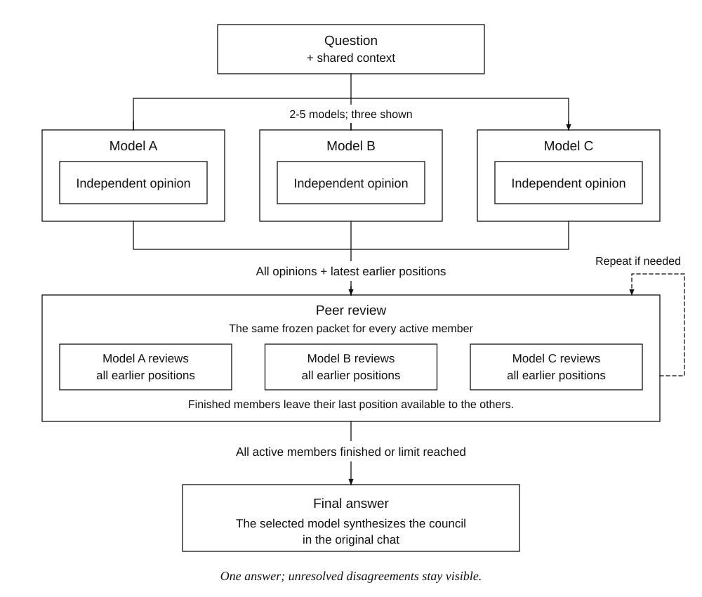
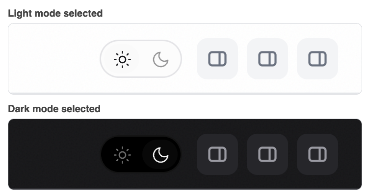
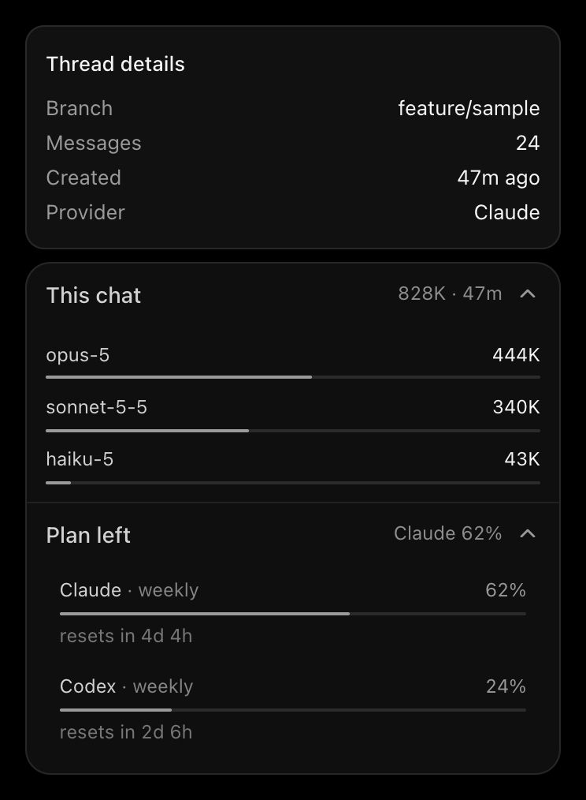
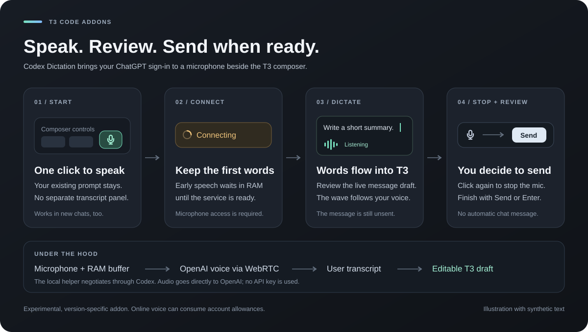

# T3 Code Addons

Independent modular addons for T3 Code. Keep custom features separate from upstream T3 development, with explicit compatibility checks and reversible installation.

Unofficial, version-specific extensions; not affiliated with T3 Tools.

## Addons

- **[Model Council](addons/model-council/README.md)** — Independent opinions from 2–5 models, peer review, per-model thinking effort, and one final answer in the current chat.



Review rounds are configurable, members can finish early, and the final answer preserves unresolved disagreements.

- **[Theme Toggle](addons/theme-toggle/README.md)** — A light/dark switch next to T3's header buttons.



*Rendered from the addon's own code inside a mock T3 header with sample data; the header buttons are stand-ins for T3's own.*

- **[Thread Details](addons/thread-details/README.md)** — A companion card under T3's own thread-details card: this chat's tokens per model with hover details, and what is left of each provider's subscription limits.



*Rendered from the addon's own code with fabricated sample data; the upper card is a stand-in for T3's own.*

- **[Orchestrator](addons/orchestrator/README.md)** — A composer button that turns the chat's agent into a coordinator that only delegates to subagents, with frugal delegation rules (small agent budgets, one reused subagent per role, short replies, review in proportion to risk) and a right-click menu for the default subagent model and subagent effort. Version 0.3. Also works on the new-chat screen.


- **[Codex Dictation](addons/codex-dictation/README.md)** — A microphone beside the composer addon buttons that streams speech directly into the message draft. Click again to stop, then send normally. Includes startup speech buffering, clear connection states, and a waveform that responds to your voice. Uses Codex's ChatGPT sign-in and a journaled local negotiation helper; no API key is used.



*Illustrated with synthetic text. Dictation fills the draft; sending remains a separate user action. Online voice usage can consume account allowances. Token savings and battery-life improvements have not been measured.*

Theme Toggle, Thread Details, Orchestrator, and Codex Dictation use small interface overlays. Each overlay adds only its own files and one `<script>` entry on top of the installed T3 Code, re-signs with the certificate already protecting the app, and withdraws only its own entries. Codex Dictation additionally installs its independent, journaled loopback helper. The overlays work with or without Model Council and in any order. Model Council's own installer restores a whole-application backup, so withdraw the overlays before running its `update` or `restore`.

## Installing the small overlays

```sh
cd addons/theme-toggle   # or addons/thread-details, addons/orchestrator, addons/codex-dictation
python3 scripts/install.py check
python3 scripts/install.py apply   # then quit and reopen T3 Code
```

On an unmodified official app, run `python3 scripts/install.py setup-signing` once first. Use `update` after changing the addon's source and `remove` to withdraw only that addon. Withdraw overlays before running Model Council's `update` or `restore`, then reinstall them. Each addon's README has the details.

## Library layout

```text
t3-code-addons/
  AGENTS.md
  README.md
  addons/
    model-council/
    theme-toggle/
    thread-details/
    orchestrator/
    codex-dictation/
      README.md
      addon.json
      src/
      scripts/
      test/
```

Each addon has its own folder, English interface and README, manifest, source code, tests, and installation tools. Start with that addon's README. No addon should need another addon's files to install or run.

Compatibility is checked per addon. Updating T3 does not automatically make an addon compatible with the new release. Keep local application backups and receipts in the external application-support directory until you have removed or migrated the addon.

Model Council uses a persistent, per-Mac signing identity to keep macOS privacy permissions stable across addon rebuilds. Run its `setup-signing` command once before installation or update; see [local signing and privacy](addons/model-council/README.md#local-signing). Each user generates their own key in Keychain. Publish only source and documentation, never generated signing files or locally signed application bundles.

## AI-assisted update lifecycle

The repository skill [t3-addon-lifecycle](.agents/skills/t3-addon-lifecycle/SKILL.md) coordinates installation records, withdrawal before official updates, and reassessment afterward. It is discoverable as a project skill in Codex. Ask the agent to use it when updating T3 or managing addons.

The agent checks whether official T3 now covers each addon's behavior and whether still-needed addons work with the exact new release. Verified compatible addons are reinstalled; adaptations and uncertain cases are reported before proceeding. Official T3 remains usable while an addon needs work. This is an AI workflow with verified installation tools, not a promise that every release can be adapted automatically.

Every application replacement keeps recoverable bundles and records intended/completed file changes outside this repository. Model Council's standalone installer includes a transaction journal and `recover` command for interrupted swaps. A workflow session also records pending restart or user-performed update steps, so another turn can resume from observed state.

Keep reference checkouts, test environments, logs, screenshots, credentials, application backups, and installation receipts outside this project. The source library must contain no personal identities, personal absolute paths, private chat data, or secrets. See each addon’s README for its external state location.
