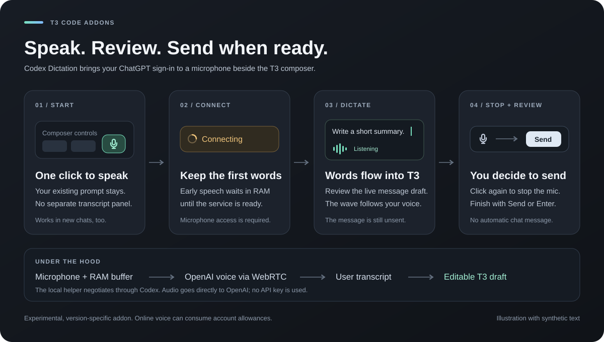

# Codex Dictation

**Version 0.3.7 · macOS · T3 Code 0.1.x (verified 0.1.7, 0.1.9) · Codex CLI 0.167.0 / 0.169.0**

Experimental speech-to-text for T3 Code using the local Codex CLI's ChatGPT sign-in. No OpenAI API key is used. Click the **microphone icon beside Orchestrator / Model Council**, speak, and click it again to stop. Words appear directly in the existing message draft as you speak. The message remains unsent; use T3's normal Send button or Enter shortcut when ready. There is no separate transcript panel or insertion step.



*An illustrated workflow using synthetic text, not a screenshot of a private conversation.*

## Quick use

1. Click the microphone beside the composer controls.
2. Speak. **Connecting** indicates startup; **Listening** and the waveform indicate that the remote voice service is ready.
3. Click again to stop the physical microphone. **Finishing** lets already captured audio and final words complete.
4. Review the ordinary T3 draft and use **Send** or the configured Enter shortcut yourself.

Existing prompt text is preserved. The addon also supports new-chat drafts, and requires neither Model Council nor Orchestrator. Those buttons are optional visual anchors.

## What is included

- Live transcription directly into the existing draft, with no separate transcript panel or insertion button.
- RAM-only startup capture so speech acquired during connection negotiation can be replayed in order.
- Distinct connection states, a real microphone-level waveform, compact controls, and reduced-motion support.
- Draft protection when the user edits, clears, or sends the original draft. Switching chats keeps transcription attached to the original draft.
- Event-driven placement, explicit resource cleanup, and no idle model session.
- A standalone installer, pinned host hashes, independent helper, recovery copies, and external transaction records.

## Recording states and startup buffering

The padded microphone button expands with an amber spinner and **Connecting** while the voice service starts, then shows **Listening** with five bars that respond to the actual microphone level. **Finishing** means the microphone is off while the buffered audio and last transcript fragments finish arriving. Reduced-motion preferences are respected. The control stays aligned with the other toolbar buttons as the draft grows. Space is measured against actual controls, including when the host's right-hand wrapper stretches across an empty gap. When space is limited it collapses to a compact icon or waveform. If the toolbar is completely full, it sits below the composer, or above the composer when the bottom of the window has no room. It does not cover draft text or Send. The addon also works without the other addons installed.

An AudioWorklet captures speech into an in-memory PCM buffer as soon as microphone access is available. The outgoing track remains silent until both the WebRTC data channel and the remote `session.started` event are ready. Buffered speech then plays into the outgoing track in its original order at normal speed, followed by live speech. This preserves words spoken during negotiation, at the cost of a short startup backlog. OS microphone permission/device-opening delays cannot be captured; wait for **Listening** if you want an unambiguous ready signal. A connection delay beyond the bounded buffer fails visibly instead of silently dropping its beginning.

Clicking again mutes the physical microphone immediately. The remaining captured audio drains before the connection closes; the text stays in the draft and is never automatically sent. Focus returns to the editor for its normal sending shortcut.

## How it works

A small loopback helper launches an isolated, ephemeral Codex app-server session only while recording. It negotiates a v3 WebRTC voice connection using Codex's own authentication. Browser audio flows directly to OpenAI; the helper sees negotiation data, not audio. Only explicit `input_transcript.added` items enter the transcript. Assistant speech, text output, and delegation requests are ignored. Assistant audio is never played. Unexpected backing-agent turns terminate the isolated process; tool requests are rejected.

This uses a conversational voice session, not the standalone ChatGPT dictation endpoint. Exact model parity, identical accuracy, subscription limits, and long-term availability are not established. The voice service may generate an ignored assistant response. This is online processing and may consume account voice allowances. No claim of free or unlimited usage is made.

Recording continues when switching apps, windows, browser tabs, or T3 chats, until you click Stop. Transcript fragments always update the draft where recording began, even while viewing another chat. A floating Stop control remains available on pages without a composer. There is no addon-imposed recording duration limit. Closing/reloading the T3 window, microphone or network errors, and service-side limits can still end a session. User edits and sending/clearing the prompt take priority: the next transcript fragment stops dictation instead of overwriting an edited draft or recreating a sent message. Duplicate transcript items are replaced instead of appended twice.

The addon keeps no separate audio recordings or transcript logs. The startup audio buffer lives only in RAM and is discarded when the connection closes. Dictated text becomes an ordinary T3 draft and follows T3's normal draft persistence. Codex and OpenAI's own processing and retention policies still apply.

## Resource use

Idle dictation does not create an AudioContext, microphone stream, WebRTC peer, Codex process, or remote voice session. The small loopback helper remains available. Placement is event-driven and coalesced to one update per animation frame; composer resizing is observed explicitly, without polling. Waveform styles update only when the quantized level changes. Hidden windows keep recording while waveform painting and placement work are suspended.

Recording requires microphone processing, PCM buffering/replay, WebRTC encoding, and an online conversational voice session. The startup buffer is capped at 45 seconds (about 8.6 MB of mono float PCM at 48 kHz); this bounds startup buffering, not the recording duration. Stopping releases tracks, the audio graph, peer, timers, and isolated Codex process. Continuous background recording continues to use microphone, network, battery, and account allowances until stopped. There is no addon duration cutoff, battery benchmark, or account-usage meter. The remote service may produce ignored assistant output, so zero token/quota cost cannot be guaranteed. No additional coding/model turns are requested for dictation, and unexpected agent turns are terminated.

## Compatibility

- macOS; any T3 Code **0.1.x** host in which the draft store and composer markers are discovered (see below). Verified: **0.1.7** (`322f6544dfad`) and **0.1.9** (`24e77473ecf4`).
- Codex CLI signed in with a ChatGPT account (API-key-only sessions are refused). Verified: **0.167.0** and **0.169.0**. The helper never blocks on a version number: `apply`/`update` run a read-only capability probe that starts `codex app-server`, completes the `initialize` handshake, reads the account, and checks that `thread/start` and `thread/realtime/start` exist by sending deliberately invalid parameters (no thread, voice session, or model turn is created). Only a real protocol mismatch (handshake fails, a method is missing, or a reply has a different shape) refuses installation with a clear message; at runtime the same condition is shown once in the widget's info note.
- Python 3.9 or newer and an existing persistent signing certificate pinned in T3, as used by the independent overlay installers.
- Desktop origin `t3code://app`. Remote/browser clients are intentionally not allowed to control this machine's microphone helper.

The addon does not pin a hashed T3 chunk. At `check`, `apply`, and `update`, `scripts/discover.py` scans the target client's top-level `assets/*.js` for the module that defines and exports the composer draft store (an object with `getComposerDraft` and `setPrompt` actions), resolves its minified export alias from that module's export list, and renders `src/host.template` into the installed `host.mjs` with the discovered chunk name and alias. The three composer markers (`data-chat-composer-form`, `-footer`, `-actions`) must also exist in the client. The discovered chunk's SHA-256 is recorded in the install receipt (`hostDiscovery`), not in `compatibility.json`. If the store or markers cannot be found, or more than one candidate exists, installation stops with a clear error. If a store that was found at install time later lacks the draft actions at runtime, the widget shows its info note instead of recording. Ordinary version differences within 0.1.x are not reported. After an official T3 update, run `update` (or withdraw and reinstall) so the adapter is regenerated for the new chunk name. This requires a modified, re-signed application bundle; external addon loading is not assumed. Other addons are preserved. The addon is self-contained and does not import sibling addons.

## Install and verify

Follow the T3 Adds lifecycle coordination before application mutations. Keep a durable external lifecycle session and reconcile any unfinished operation first.

From this addon directory:

```sh
npm test
python3 scripts/install.py check
python3 scripts/install.py apply
```

`apply` installs the journaled helper and overlay. It checks the exact T3 build and host module hashes, stages and verifies the application, preserves the previous application, records logical archive changes and complete file inventories, reuses the pinned signing certificate, and swaps the application atomically. Restart T3 after installation. This does not restart an active agent's own host.

```sh
python3 scripts/install.py check
python3 scripts/service.py check
```

The helper listens only on `127.0.0.1:48173`. Its HTTP operations require the exact desktop Origin, loopback Host, and a custom request header. A LaunchAgent keeps the idle negotiation helper available; no Codex process, microphone, timer loop, or model session is started while idle. The helper rejects simultaneous recording sessions. While recording, the renderer renews an ownership lease every 30 seconds, including in the background. If the renderer closes or crashes and stops renewing for three minutes, the helper closes the abandoned session. This timeout measures missing client contact, not recording duration. Normal window unloading also sends a keepalive-enabled stop request.

Local state is stored under the operating system application-support directory, in `T3 Adds/codex-dictation/`, or under `T3_ADDS_STATE_DIR` when configured. It contains app recovery copies, receipts, helper runtime files, and transaction journals. The LaunchAgent plist is under the user's `Library/LaunchAgents` directory. Neither location belongs in the source repository.

## Update, remove, and recover

```sh
python3 scripts/install.py update
python3 scripts/install.py remove
```

Removal withdraws only recorded overlay entries, preserves other addons and official files, and removes the recorded helper and LaunchAgent. Changed helper or overlay files are never overwritten silently. Keep the external state for recovery. Before an official T3 update or a Model Council restore/update, withdraw this overlay along with the other overlays; reassess and verify compatibility afterward.

```sh
python3 scripts/install.py recover
python3 scripts/service.py recover
```

The helper has its own write-ahead journal. Recovery restores its known previous files and service state and refuses unexpected file contents. `scripts/service.py install`, `check`, and `remove` can repair or withdraw the helper independently. If a new official T3 build removed the overlay, confirm its absence and use `scripts/install.py forget` to archive the stale application receipt; remove the helper separately.

## Development and validation

`npm test` covers live draft updates, immediate microphone muting, late fragments, user edits and sends during recording, navigation, transcript replay, input/output separation, microphone cleanup, HTTP trust boundaries, helper ownership and rollback, layered ASAR changes, and installation recovery.

Extract client assets to an external directory:

```sh
python3 scripts/extract_client.py '/Applications/T3 Code (Beta).app' /external/client
T3_ADDS_PLAYWRIGHT=/external/node_modules/playwright-core node scripts/verify_host.mjs /external/client/assets
```

The mock-page test loads real host modules and fresh addon sources with a synthetic voice transport. It verifies live draft writing, immediate mute, final fragments, normal manual Enter-to-send, placement beside the other addon buttons, existing and new chats, and narrow windows. The widget is mounted outside React-owned DOM and only reads the footer's geometry. Playwright dependencies and screenshots must stay outside this addon.

An explicitly authorized live check can use a synthetic WAV recording without opening a real microphone:

```sh
T3_ADDS_PLAYWRIGHT=/external/node_modules/playwright-core node scripts/verify_voice.mjs /external/sample.wav
```

This creates a temporary real OpenAI voice connection. It starts the synthetic speaker before a deliberately delayed negotiation and exercises the production AudioWorklet, buffer, WebRTC connection, audio-level reporting, and transcript parser. Pass an expected opening phrase as a second argument to assert that the early words survive. Unit and host checks do not make model calls. Synthetic voice success does not establish real-window microphone permissions or identical behavior to ChatGPT dictation; those require a user trial in the installed app.
