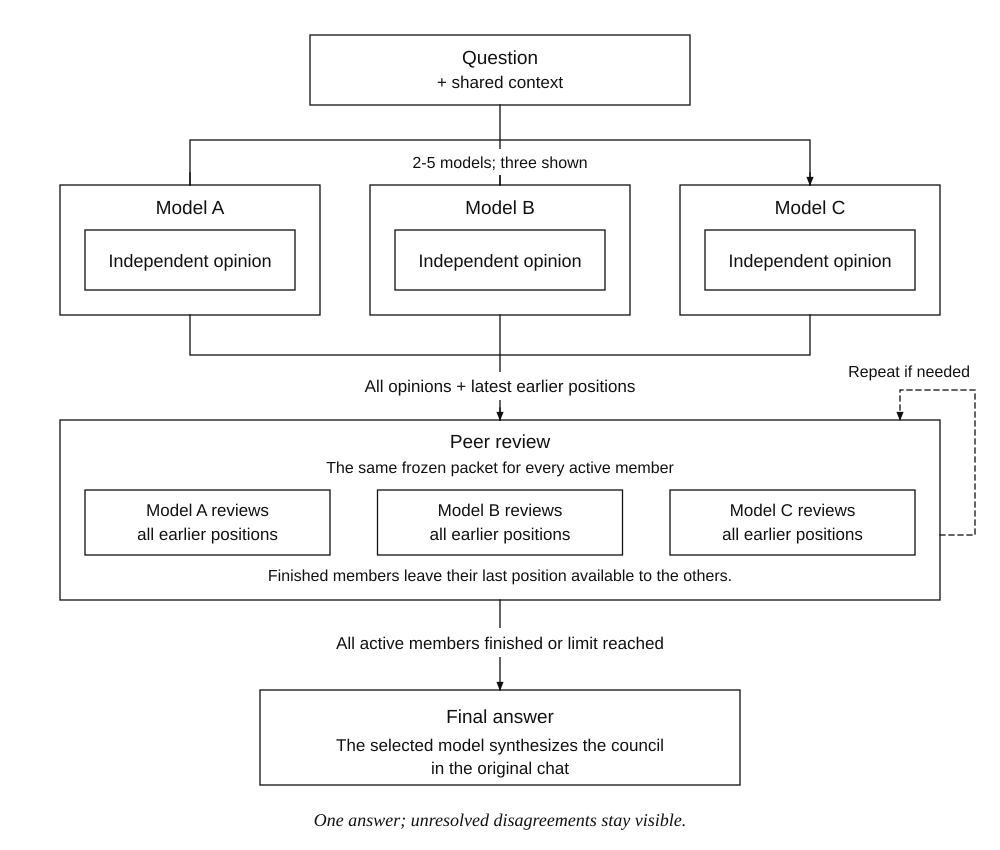

# Model Council

A T3 Adds addon that gathers independent opinions from 2–5 models, runs configurable peer-review rounds with individual early completion, and presents one final answer through the model selected in your current T3 chat.

This folder contains the source, manifest, tests, and installation tools. It works independently of the rest of the addon library and does not require a T3 source checkout.



Three members are shown; a council supports 2–5. Finishing a review does not imply agreement. The final answer preserves unresolved disagreements.

## Requirements

- macOS with **T3 Code Beta 0.1.7**, source commit **`322f6544dfad`**.
- Python 3 and the macOS `ditto` and `codesign` commands for installation.
- Node.js 20+ and npm for optional automated tests.
- At least two usable model selections in T3. Provider subscriptions and usage limits still apply.

This is a local application modification, not an official T3 plugin API. The installer checks the exact build and host-file hashes. It refuses unsupported builds; a newer T3 release requires a compatibility review first.

## Install

From the T3 Adds library root:

```sh
cd addons/model-council
python3 scripts/install.py check
python3 scripts/install.py apply
```

If you copied the addon elsewhere, open that folder directly instead of using the `cd` command above. Everything else works the same way.

The default target is `/Applications/T3 Code (Beta).app`. For another installation, pass `--app` to each command:

```sh
python3 scripts/install.py check --app "/path/to/T3 Code (Beta).app"
python3 scripts/install.py apply --app "/path/to/T3 Code (Beta).app"
```

`apply` builds and verifies a separate application copy, saves the complete original app in the external local-state directory, and installs the prepared copy. It does not modify the conversation database or quit the running app. **Quit and reopen T3 Code afterward.**

To prepare a copy before installing, run `python3 scripts/install.py stage`, then `python3 scripts/install.py apply`.

### Local signing

The modified app uses an ad-hoc local signature. Apple-issued distributor identity and keychain-group entitlements cannot be preserved with that signature, so T3's distributor-bound Touch ID/passkey integration may be affected. Provider credentials are not rewritten. The complete original signed app is retained for restoration.

## Use

1. Open an existing chat and click **Model Council** next to the attachment button inside the composer.
2. Enter a question. Expand **Add models**, select models from the provider lists, and click **Add**. Selected models appear as separate cards under **Council members**.
3. Choose each member's thinking or reasoning level in its card, where supported. **Default** leaves that setting to T3/the provider.
4. Set **Maximum rounds** to a whole number of at least 2 (default: 2). The independent opinion counts as round 1; the final answer is separate.
5. Click **Start council**.
6. Inspect independent opinions and peer reviews in the council card, or open each member's native T3 chat.

Each member gives an independent opinion, then reviews the initial opinions and the latest earlier position of every member. All participating models receive the same frozen packet for a round. Member effort settings are preserved across rounds. The limit is a maximum, not a required number of turns: for example, a limit of 5 can finish at round 3. The model currently selected in the main chat produces the final answer using its existing model and effort settings.

Each reviewer is instructed to stop participating when more discussion would not materially improve its recommendation, using an exact final control line: `{"councilStatus":"done"}`. A `continue` line or a missing/malformed signal keeps that member eligible until the limit. A finished member receives no more turns, while its last position remains visible to other members. Once all remaining members finish, or the maximum is reached, synthesis starts. Finishing does not imply agreement.

The council preserves unresolved disagreements. Failed members are reported and are never silently replaced. At least two independent opinions and one completed peer review are required for a final answer.

Use **Stop** to stop members and, when applicable, the council's final-answer turn. If the main chat is busy, the council enters **Ready**; click **Send final answer to chat** when the other work finishes.

After the final answer completes, the addon automatically settles the member chats through T3's native `thread.auto-settle` command. It also attempts cleanup after cancellation or failure. It preserves the chat history and does not settle the original chat. Active, reused, pinned, explicitly kept-active, or concurrently changed member chats are skipped and the council card reports the reason. Pending cleanup resumes after reopening; older completed councils are left unchanged.

## Update the addon

After changing or replacing source files in this folder:

```sh
python3 scripts/install.py update
```

This rebuilds from the recorded original app, retains the original backup, saves the previous addon installation, and updates the receipt. Restart T3 afterward.

Keep the external local-state directory: it contains the original app and receipt needed for updates and restoration. Moving or copying the addon source folder does not move private machine state or break its backup references on the same machine.

The installer records full original/installed bundle inventories (file hashes, modes, symlinks), logical ASAR changes, host identity, and addon source hashes. It writes transaction intent before replacing the application and keeps both recovery copies. Staged apps are tied to the original and source hashes. Legacy receipts are adopted only after reconstructing the current installation from its signed original; this verifies current state rather than claiming a complete historical audit. ACLs and extended attributes are not inventoried; application copies use macOS `ditto` and signatures are verified separately.

An unfinished operation blocks new installation operations. Reconcile it with:

```sh
python3 scripts/install.py recover
```

Recovery only accepts recorded bundle contents and refuses unexpected application changes. It does not modify chats or council records. All installer commands share an exclusive lock.

If T3 itself has updated, the installer refuses to overwrite it. Review the new release and update the adapter and compatibility manifest before applying the addon again.

## Remove and restore

```sh
python3 scripts/install.py restore
```

Restart T3 afterward. Restoration puts back the original signed app and refuses to overwrite an application that changed after injection. It does not delete council records or member conversations.

Restoration retains the signed original backup and the withdrawn application. Its transaction archives the installation receipt. After withdrawal, an extracted newer official app may be installed with `python3 scripts/install.py install-official --candidate "/external/staging/T3 Code (Beta).app"`. The candidate must have a valid signature, matching distributor team and bundle ID, and a newer stable numeric version. This records the host replacement, keeps the previous application, and leaves the addon withdrawn. Restart T3 and reassess compatibility before reinstalling; this command does not update the addon's compatibility metadata.

## Folder contents

```text
model-council/
  README.md              Installation and usage
  addon.json             Name, version, and supported T3 build
  compatibility.json     Host-file SHA-256 hashes
  integration.patch      Client entry-point change
  src/                   UI, protocol, controller, effort, storage, host adapter
  scripts/               Installer, ASAR utility, installer tests
  test/                  Automated tests
  package.json           Optional test dependencies and command shortcuts
  package-lock.json      Reproducible test dependency versions
  T3-Code-LICENSE         Upstream MIT notice
```

For sharing, copy the source and documentation while excluding installed `node_modules/` and generated files. No files from a sibling addon or the library root are required. Private runtime state must stay outside the source folder.

## Local state and privacy

Application backups, the installation receipt, and staged applications are stored outside the project. On macOS the default location is:

```text
$HOME/Library/Application Support/T3 Adds/model-council/
  backups/
  .cache/staged/
```

The home directory is resolved at runtime; no personal path is embedded in the addon. Set `T3_ADDS_STATE_DIR` to an external parent directory to use another location; the installer appends `model-council/`. Use the same setting for install, update, and restore commands.

Do not commit or share local receipts, application backups, test-server profiles, logs, browser authentication state, credentials, or private chat exports. Isolated integration tests must also use a data directory outside this project. Python bytecode generation is disabled by the installer and its test runner to avoid writing compiled files containing local source paths.

## Context and limitations

The starting conversation selection is frozen once and shared by all members. Its default budget is 16,000 UTF-8 bytes, prioritizing the original request and recent exchanges. Members receive a source-thread reference for retrieving omitted history. Attachments and private reasoning are not copied. Contributions above 24,000 bytes are shortened explicitly; the full output remains in the native member chat.

All round responses remain in the local council record and member chats. Final-answer context contains the original opinions, latest reviews, and completion metadata to keep its size bounded regardless of the round limit; earlier reviews can be retrieved from member chats. There is no fixed upper limit beyond a safe integer, so large values can consume substantial model usage if members keep discussing.

The frontend coordinates later rounds. Closing its window may leave an already-started native turn running; reopening T3 resumes remaining steps. Stable per-round command IDs prevent resending accepted turns. In-progress records from the previous two-round format retain their limit and accepted message IDs. Web Locks coordinate execution across windows. Council records live in the browser profile's IndexedDB and do not sync across devices.

Members run in the same project, branch, and workspace, in plan mode with advice-only instructions. These instructions are not an operating-system sandbox; T3's permissions remain authoritative. An opinion request does not authorize implementation work.

The UI applies to the local desktop app and the web frontend it serves. It does not modify the official mobile app or the independently hosted `app.t3.codes` frontend. Native member conversations remain regular T3 conversations.

## Test

From this folder:

```sh
npm ci
npm test
```

Tests cover context selection, common inputs, custom round limits, individual early completion, frozen round packets, legacy records, settlement safeguards and cleanup recovery, round order, effort forwarding, partial failure, cancellation, timeouts, resume idempotency, busy parent chats, durable storage, and ASAR rewriting. They do not call paid model APIs. The installer also verifies the prepared app's signature and ASAR integrity.

The configurable-round and automatic-settlement upgrade is covered by simulated controller tests and inspection of the pinned host command schema and handler; it has not been exercised with paid model runs.

Previous live checks verified the native T3 UI/RPC path and final context delivery to Codex. The cross-provider live check was limited by the Claude account's usage cap; not every provider/model combination has been tested.

## T3 0.1.7 adaptation

Addon 0.3.2 targets official T3 0.1.7 / `322f6544dfad`. The host adapter uses the verified atom registry, thread detail/shell, provider configuration, scope, orchestration, and transcript exports from this exact application build. The native multi-model sender starts separate background threads; it does not replace Council's peer-review rounds and final synthesis.

Reasoning controls also honor T3 0.1.7's explicit `role: "reasoning"` descriptor, including provider-specific option IDs, while preserving existing choices and excluding prompt-only levels.

Settlement snapshots remain ISO strings in durable council records. The adapter decodes them to native Effect DateTime values before invoking `thread.auto-settle`; passing persisted strings directly does not meet the native command schema. The controller also accepts native DateTime timestamps when creating the persisted snapshot. Existing ownership, pin, explicit active-state, and concurrent-change safeguards remain in place.

`test/controller.test.mjs` covers settlement with native timestamp shapes. The optional `scripts/verify_host.mjs` imports the real official bundles in an isolated Chromium context, checks adapter reads and command forwarding with fixture-backed atoms, and opens the Council dialog. It fulfills requests from extracted local assets without a server, live profile, credentials, or model calls. Install `playwright-core` only in an external test copy; pass the extracted official client assets directory as its argument. Set `T3_ADDS_TEST_BROWSER` to an existing Chromium executable, or use a Playwright-managed browser. Keep that test copy and its dependencies outside this repository.

These checks verify the bundled adapter and date conversion, not a paid end-to-end council or a live server settlement. After installation, restart T3 to load the new UI.
