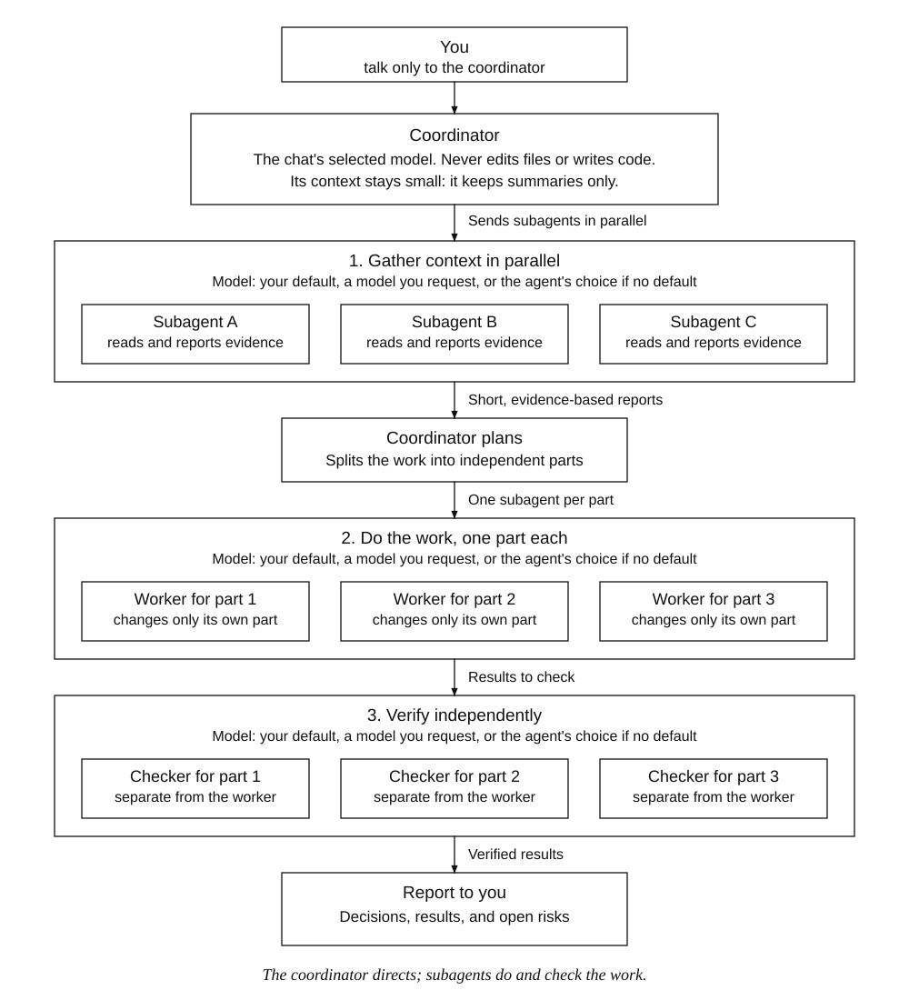

# Orchestrator

A T3 Adds addon that turns the agent you talk to into a team lead. With Orchestrator on, that agent never writes code or changes anything. It sends subagents to gather real context, plans from their reports, splits the work, sends other subagents to do each part, and sends independent subagents to check the results. Its own context stays small, so it keeps the whole picture instead of forgetting it.

This folder contains the source, manifest, tests, and installation tools. It works independently of every other addon and does not require a T3 source checkout.



Every subagent uses the default subagent model from the right-click menu, a model you request for a single task, or the coordinator's own choice when **No default** is set. The coordinator itself stays on the chat's selected model.

## Requirements

- macOS with **T3 Code Beta 0.1.7**, source commit **`322f6544dfad`**.
- Python 3 and the macOS `ditto`, `codesign`, and `security` commands for installation.
- Node.js 20+ for the tests.

This is a local application modification, not an official T3 plugin API. The installer checks the exact build and the hashes of the host files it imports, and refuses unsupported builds.

## Install

```sh
cd addons/orchestrator
python3 scripts/install.py check
python3 scripts/install.py apply
```

If the installed application is already signed by a T3 Adds local certificate (for example after installing Model Council), `apply` re-signs with that same certificate. On an unmodified official app, run `python3 scripts/install.py setup-signing` once first, as described in the Model Council README. Quit and reopen T3 Code afterward.

## Use

- The **Orchestrator** button sits in the composer next to **Model Council**. It is off by default in every chat.
- Click it to turn it on. It shows **Starting…** until T3 accepts the rules, then turns green. If the chat is busy, the rules are queued behind the current work. Click again to end coordinator mode.
- Right-click (or press the context-menu key) for options:
  - **Default subagent model**: the model subagents use unless told otherwise. **No default** lets the agent choose.
  - **Remind now**: re-sends a short reminder of the rules.
- The chat's own agent always stays on the model selected in the chat.
- To use a specific model for one task, say so in plain words ("use model X for this one"). The coordinator is told to follow an explicit request over the default.

## How it works

Turning it on posts one message into the chat, starting with `[T3 Adds · Orchestrator]`, that states the coordinator rules. Turning it off, changing the default model, or choosing Remind posts a short message the same way. Subagents are T3's existing subagents: the provider's native tool (Claude `Agent`, Codex `spawn_agent`) for the same provider, and T3's `delegate_task` for another provider or model. Nothing in T3 is patched.

The on/off state per chat and the default model are kept in the browser profile's local storage. If storage is blocked, they last for the session.

## Limitations

- The rules are instructions, not a sandbox. T3's permissions remain authoritative, and an agent that ignores the rules can still change files. The button turning green means the rules were delivered, not that they are enforced.
- In very long chats the rules can fade. Use **Remind now**. Automatic per-message reminders would need hooking T3's composer, which this addon does not do.
- The rule messages are visible in the chat and use the chat's normal turn, so they use a little model usage.
- Models you pick must be enabled in T3. A saved default that is no longer available is ignored.

## Update and remove

```sh
python3 scripts/install.py update    # after changing source files in this folder
python3 scripts/install.py remove    # withdraw this addon only
python3 scripts/install.py recover   # reconcile an interrupted operation
python3 scripts/install.py forget    # archive a stale receipt after an official T3 update
```

Removal deletes only what this addon added. Model Council's `update` and `restore` refuse while an overlay is installed; withdraw overlays first.

## Test

```sh
npm test
```

Covers the rules text, persisted state (including blocked storage), the controller (queueing when busy, permission and failure handling, unavailable defaults), model options and routing, and the installer against a synthetic app. `scripts/verify_host.mjs` imports the real official bundles in an isolated Chromium and checks the adapter; see Theme Toggle's README for running it from an external test copy.

Not exercised: a real T3 window, a real model following the rules, and the button/menu layout in the live composer.
