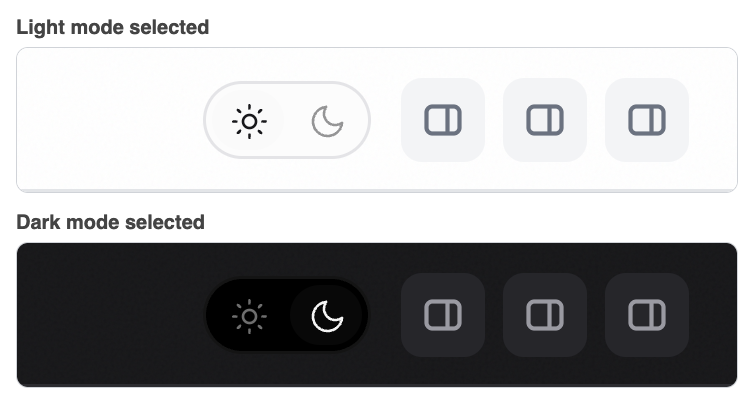

# Theme Toggle

A T3 Adds addon that puts a small light/dark switch next to T3's header buttons. One click pins the appearance; T3's own theme system does the work, so custom themes and the "follow system" setting keep working.

This folder contains the source, manifest, tests, and installation tools. It works independently of every other addon and does not require a T3 source checkout.



*Rendered from the addon's own code inside a mock T3 header with sample data; the header buttons are stand-ins for T3's own.*

## Requirements

- macOS with **T3 Code Beta 0.1.7**, source commit **`322f6544dfad`**.
- Python 3 and the macOS `ditto`, `codesign`, and `security` commands for installation.
- Node.js 20+ for the tests.

This is a local application modification, not an official T3 plugin API. The installer checks the exact build and the hash of the one host file it imports. It refuses unsupported builds; a newer T3 release needs a compatibility review first.

## Install

```sh
cd addons/theme-toggle
python3 scripts/install.py check
python3 scripts/install.py apply
```

If the installed application is already signed by a T3 Adds local certificate (for example after installing Model Council), `apply` re-signs with that same certificate so macOS privacy permissions stay attached. On an unmodified official app, run `python3 scripts/install.py setup-signing` once first; it creates a local code-signing certificate in your Keychain, as described in the Model Council README.

`apply` copies the installed app, adds only this addon's files and one `<script>` entry, verifies that nothing else in the application archive changed, signs and verifies the copy, and swaps it in atomically. The previous app stays recoverable in the external state directory. **Quit and reopen T3 Code afterward.**

## Use

Click the sun or moon in the top-right corner. The active mode is highlighted. If T3 is following the system theme, hovering the switch says so; clicking either icon pins that mode.

The switch finds T3's own header buttons ("Toggle thread details panel", "Toggle terminal drawer", "Toggle right panel") and lines itself up directly left of them, centered on their row, at any window size. It is excluded from the desktop window-drag region so clicks reach it. If those buttons are not found, it falls back to fixed offsets that you can change with `--t3-adds-theme-toggle-right` and `--t3-adds-theme-toggle-top` on `:root`.

## Update and remove

```sh
python3 scripts/install.py update    # after changing source files in this folder
python3 scripts/install.py remove    # withdraw this addon only
python3 scripts/install.py recover   # reconcile an interrupted operation
python3 scripts/install.py forget    # archive a stale receipt after an official T3 update
```

`remove` deletes only this addon's files and its one `index.html` entry from the installed application. It never restores a whole-application backup, so other addons and official files are untouched, and it refuses to run if this addon's files were changed. Because the installed archive differs from what Model Council's installer recorded, withdraw this addon before running Model Council's `update` or `restore`, then install it again.

Before an official T3 update, withdraw every addon with its own `remove`. After updating, check compatibility again before reinstalling.

All installer commands share one lock across T3 Adds addons. Receipts and transaction records live in the external state directory (`T3_ADDS_STATE_DIR`, default `~/Library/Application Support/T3 Adds/theme-toggle`), never in this repository.

## Validation

```sh
npm test
python3 scripts/extract_client.py "/Applications/T3 Code (Beta).app" /external/empty/client
# in an external copy with playwright-core installed:
T3_ADDS_TEST_BROWSER="/path/to/Chrome" node scripts/verify_host.mjs /external/empty/client/assets
```

`npm test` covers the toggle logic, the ASAR add/remove tooling, and layered install, update, and withdrawal against a synthetic application. `verify_host.mjs` loads T3's real theme module in headless Chrome and checks that the switch changes the application theme. Neither starts a model run or touches a real application.

## Limitations

- Verified only against T3 Code Beta 0.1.7. The addon imports a hashed internal module, so any T3 rebuild that changes that module needs an adapter update.
- Placement is a fixed overlay aligned to T3's header buttons by their accessible labels, not a slot in T3's header. If a T3 release renames those labels it uses the fallback offsets. It is hidden below 560 px width.
- Each install, update, or removal keeps the previous application (about 460 MB) under `backups/` in the external state directory so it stays recoverable. Delete old copies yourself once you trust the current state.
- Real-window placement and the installer's signing and application swap were not exercised against `/Applications` by the test suite.
