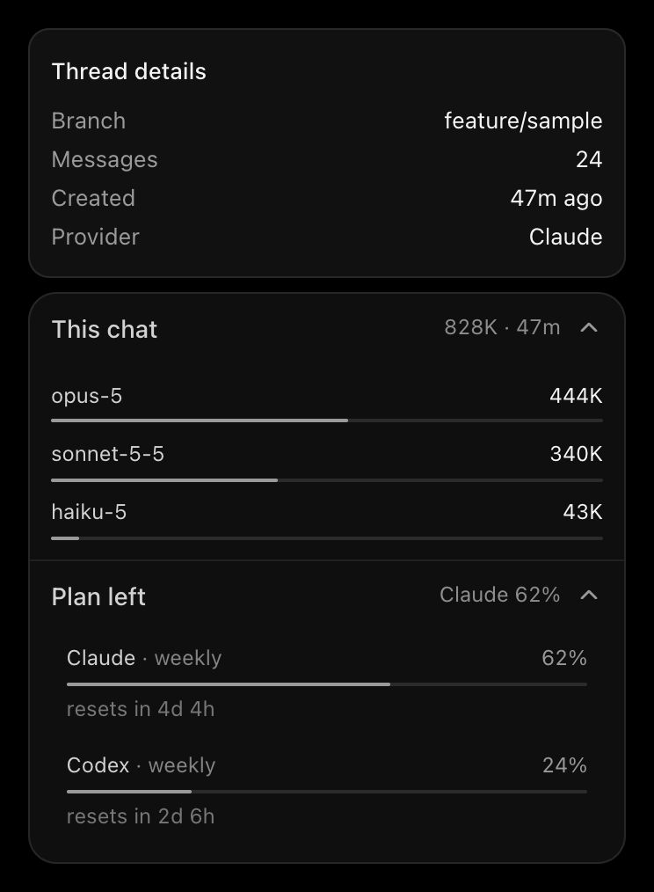

# Thread Details

A T3 Adds addon that attaches a companion card directly under T3's own thread-details card (the one the "Toggle thread details" header button opens). It has two collapsible sections:

- **This chat**: the section header shows the chat's total tokens and age. Opened, it lists one row per model (stacked) with its tokens and share; models with no tokens are left out. Hover a row for its input, cached share, output, and turn count.
- **Plan left**: every provider's tightest subscription-limit window with its remaining percent, bar, and time until reset. The header shows one provider's figure: this chat's own provider by default, or whichever you click.

This folder contains the source, manifest, tests, and installation tools. It works independently of every other addon and does not require a T3 source checkout.



*Rendered from the addon's own code with fabricated sample data; the upper card is a stand-in for T3's own.*

## Requirements

- macOS with **T3 Code Beta 0.1.7**, source commit **`322f6544dfad`**.
- Python 3 and the macOS `ditto`, `codesign`, and `security` commands for installation.
- Node.js 20+ for the tests.

This is a local application modification, not an official T3 plugin API. The installer checks the exact build and the hashes of the three host files it imports. It refuses unsupported builds; a newer T3 release needs a compatibility review first.

## Install

```sh
cd addons/thread-details
python3 scripts/install.py check
python3 scripts/install.py apply
```

If the installed application is already signed by a T3 Adds local certificate (for example after installing Model Council), `apply` re-signs with that same certificate so macOS privacy permissions stay attached. On an unmodified official app, run `python3 scripts/install.py setup-signing` once first.

`apply` copies the installed app, adds only this addon's files and one `<script>` entry, verifies that nothing else in the application archive changed, signs and verifies the copy, and swaps it in atomically. The previous app stays recoverable in the external state directory. **Quit and reopen T3 Code afterward.**

## Use

- Open T3's thread-details card as usual. The companion card appears right under it, with the same left edge and width, and moves up or down when T3's card grows or shrinks (for example when a Servers section appears). When T3's card is closed, the companion card is hidden.
- Both sections start collapsed, each with a one-line summary. Click a section to open it; the choice is remembered in the browser.
- In **Plan left**, click a provider to make it the one summarized in the section header. The list itself does not change. Your pick lasts for the current chat; another chat starts from its own provider again.
- If there is not enough room below T3's card, the companion card shortens to fit and scrolls inside.

T3's own card is never modified: the addon only reads its position. T3 sizes that card itself, and adding elements inside it could disturb that.

## Performance

- Nothing runs while T3's details card is closed.
- While it is open, data repaints at most once per second (immediately on your own clicks), and the only timer is a 30-second clock refresh. Everything pauses while the T3 window is in the background.
- Opening and closing T3's card is detected from clicks, shortcuts, and route changes, plus a size observer on the card. There is no polling.

## Update and remove

```sh
python3 scripts/install.py update    # after changing source files in this folder
python3 scripts/install.py remove    # withdraw this addon only
python3 scripts/install.py recover   # reconcile an interrupted operation
python3 scripts/install.py forget    # archive a stale receipt after an official T3 update
```

`remove` deletes only this addon's files and its one `index.html` entry from the installed application. It never restores a whole-application backup, so other addons and official files are untouched, and it refuses to run if this addon's files were changed. Because the installed archive differs from what Model Council's installer recorded, withdraw this addon before running Model Council's `update` or `restore`, then install it again.

Before an official T3 update, withdraw every addon with its own `remove`. After updating, check compatibility again before reinstalling.

All installer commands share one lock across T3 Adds addons. Receipts and transaction records live in the external state directory (`T3_ADDS_STATE_DIR`, default `~/Library/Application Support/T3 Adds/thread-details`), never in this repository.

## Data sources

Token counts come from the chat's recorded provider turns; limits come from the provider usage data T3 already fetches. The addon only reads them. If a provider reports no limit data, its row is omitted; a window that has already reset counts as fully available.

## Validation

```sh
npm test
python3 scripts/extract_client.py "/Applications/T3 Code (Beta).app" /external/empty/client
# in an external copy with playwright-core installed:
T3_ADDS_TEST_BROWSER="/path/to/Chrome" node scripts/verify_host.mjs /external/empty/client/assets
```

`npm test` covers usage and limit calculations, card placement rules, the ASAR add/remove tooling, and layered install, update, and withdrawal against a synthetic application. `verify_host.mjs` loads T3's real host modules in headless Chrome with mocked data and a stand-in details card, and checks mounting, attachment under the card, collapsed summaries, model rows with hover details, plan rows with reset times, following the card as it resizes, hiding when it closes, and route changes. Neither starts a model run or touches a real application.

## Limitations

- Verified only against T3 Code Beta 0.1.7. The addon imports hashed internal modules and finds T3's card through its `data-thread-details-card` attribute, so a T3 rebuild that changes either needs an adapter update. If the card is not found, the companion card stays hidden.
- T3 can show thread details in more than one way; only the floating card was exercised. Other presentations were not verified.
- The plan provider shown by default is the chat's recorded model. Switching models in the message box before sending does not change it until the chat records that model.
- Hover details use the browser's own tooltip, which appears after a short delay.
- Real-window behavior and the installer's signing and application swap are not exercised against `/Applications` by the test suite.
- Each install, update, or removal keeps the previous application (about 460 MB) under `backups/` in the external state directory. Delete old copies yourself once you trust the current state.
